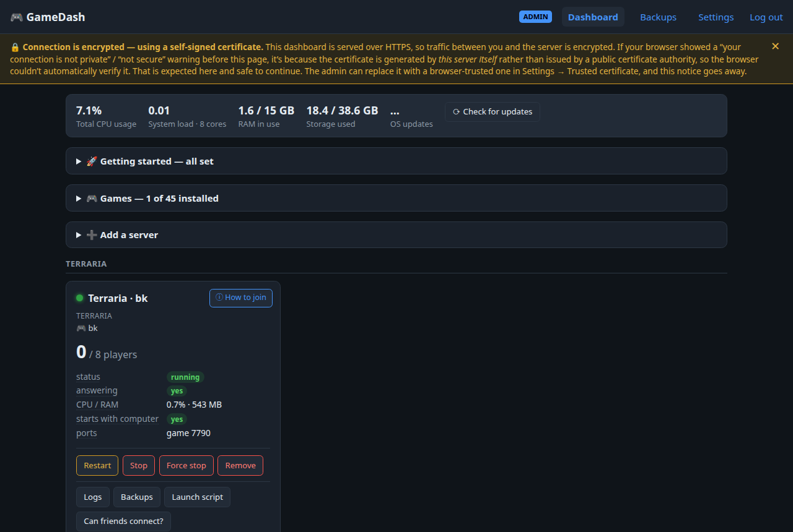

# WorldCradle™

*A Cradle for your Worlds.*

A self-hosted **web panel for running game dedicated servers** on a Linux machine —
install a game, create servers, see who's online, start/stop, back up and restore,
all from one page. Built to be usable by people with little technical knowledge.
Python + Flask, runs as a systemd **user** service and serves HTTPS directly.

**45 games** are supported out of the box (Minecraft, Valheim, ARK, Palworld,
Satisfactory, Rust, Terraria, Factorio, Counter-Strike 2, Project Zomboid, 7 Days to
Die and many more — Windows-only servers run through Wine), plus any other server as
a **custom** service. See **[docs/SUPPORTED_GAMES.md](docs/SUPPORTED_GAMES.md)** for the
full list and which games have been tested with real players.

> **Status:** early. Most games are *Not Tested* with players yet — help is welcome.



## Features
- **Live dashboard** — per-server online/offline, player counts + names, CPU/RAM,
  reachability, ports; host load. Public page shows only status + counts.
- **Controls** — start / stop / restart / **kill (no-save)** / save / broadcast,
  per-player kick/ban (RCON games), ARK live chat. Disruptive actions re-check
  live players and confirm first.
- **Games** — install any supported game's server from the dashboard; licence
  terms are linked and, where required, must be accepted.
- **Provisioning** — add servers with each game's real options and its own ports
  (blank = automatic); an optional **port pool**; a **launch-script editor**.
- **Can friends connect?** — exactly which router ports to forward (and which must
  never be forwarded), plus a reachability check.
- **Backups** — per-server save backup/restore/download/delete with per-server
  retention, an automatic **pre-restore snapshot**, and a **daily auto-backup**
  timer. ARK backups include the shared cluster (toggle on restore).
- **Settings page** — all system-wide settings in one place, including changing
  the two game-server passwords.
- **Alerts** — Discord, Telegram, email, Slack, Microsoft Teams, Pushover, ntfy, Gotify, Matrix or a
  webhook (several at once, each with a Test button): a server down, back up, unreachable or
  crashing over and over, or a backup that failed.
- **Update checks** — installed vs latest Steam build, with one-click apply.
- **Security** — built to face the internet: bcrypt login, per-IP rate-limit, CSRF on every
  change, a strict content-security policy, hardened headers and cookies, fail2ban set up by the
  package; the launch-script editor is content-validated.
- **Command line** — `worldcradle status`, `backup`, `passwords`, `reset-password` and more, for
  when the browser isn't handy.
- **Safe updates** — `sudo worldcradle update` checks the download, installs it and puts the
  previous version back by itself if the new one doesn't start. Game servers keep running.

## Quick start

On Ubuntu 22.04 or newer (Debian 12+ should work too but hasn't been tested yet), open a terminal
and type these one at a time:

1. Download WorldCradle.
   ```
   wget -O /tmp/worldcradle.deb https://github.com/KeithDude/WorldCradle/releases/latest/download/worldcradle.deb
   ```
2. Refresh the computer's list of available software.
   ```
   sudo apt update
   ```
3. Install WorldCradle and the system software the games need.
   ```
   sudo apt install /tmp/worldcradle.deb
   ```
4. Set WorldCradle up for your account and start it (no `sudo`).
   ```
   worldcradle setup
   ```

Setup ends by showing the address to open in your browser, a one-time setup code to choose your
dashboard password, and the password your friends need to join. Then follow the *Getting started*
checklist on the dashboard.

More: the step-by-step guide with screenshots, **[docs/GETTING_STARTED.md](docs/GETTING_STARTED.md)**;
installing from the source (`sudo bash install.sh`), updating and removing,
**[deploy/SETUP.md](deploy/SETUP.md)**.

## Layout
```
worldcradle/
├── app/          all application code (Flask app, games/, templates/, static/ — the page code is static/js/)
├── deploy/       systemd unit templates, the package's scripts (debian/), fail2ban, OS maintenance,
│                 the system package list (packages.conf), examples, SETUP.md
├── docs/         GETTING_STARTED.md, SUPPORTED_GAMES.md, ROADMAP.md, DEVELOPMENT_LOG.md
├── install.sh    install from the source: system packages, then setup.sh
├── setup.sh      setup for your account (`worldcradle setup`)
├── bin/          the `worldcradle` command, its self-repairing Python environment, the computer checks
├── tests/        automated tests (pytest), including recordings of what every game's setup writes
├── tools/        pre-push checks, package builder, lock-file generator, per-game end-to-end test
├── .github/      issue forms, the test and release workflows
└── requirements.txt / requirements.lock   Python libraries (the lock pins them with checksums)
```
Runtime data lives **outside the code** in the data root (so updating the code
never touches your data); [deploy/SETUP.md](deploy/SETUP.md) says where everything goes:
```
$WORLDCRADLE_HOME            (default ~/.config/worldcradle)
├── config.json  servers.json  secrets.conf  certs/  logs/
~/.local/share/worldcradle/backups/     (override with $WORLDCRADLE_BACKUPS)
~/worldcradle-games/<Game-Name>/         each game's server files (a game installed by 0.1.0 in
                                         ~/<game>server stays there)
```

## Running it
The `worldcradle` command covers the everyday jobs (`worldcradle help` lists them all):
```
worldcradle status             is it running, where to open it, and each server's state
worldcradle reset-password     choose a new dashboard password
worldcradle restart            restart the dashboard
worldcradle logs               the dashboard's recent log
worldcradle servers            list the game servers
worldcradle server restart <server>
worldcradle backup all
worldcradle passwords          show the game passwords (the one friends need to join)
sudo worldcradle update        update WorldCradle itself (rolls back if the new version fails)
worldcradle uninstall          remove WorldCradle (asks first; never deletes games or saves)
worldcradle qr                 a QR code to open the dashboard on a phone
worldcradle test-alert         send a test alert to every place alerts are set up to go
worldcradle check              quick health check
worldcradle version            the version you have (include it in bug reports)
```
- Logs also live in `logs/` in the data root: `access.log`, `audit.log`, `worldcradle.log`.
- Daily backups: `worldcradle-backup.timer` (05:00). Run on demand from
  Settings/Backups → "Back up all servers now".

## Access tiers
- **Public (no login):** each server's online/offline + player count + the in-game
  name and how-to-join address. No player names, ports, resources, or host info.
- **Admin (login):** full detail + all controls.

## Player counts
Each game uses what it offers: the Steam server query, its admin console (RCON or a
plain-text console), its log file, or its own web API. Some games offer none of these;
the dashboard then shows the server as running without a player count.

## Notes
- HTTPS is terminated directly by gunicorn with a self-signed cert; browsers warn
  once. For a certificate browsers trust, use **Settings → Trusted certificate** (free, from
  Let's Encrypt), or put your own in `<data root>/certs/`.
- Game-server passwords are stored only in the secrets file (0600), never in the
  code. The dashboard login password is a bcrypt hash in `config.json`.
- **Never forward an admin console (RCON) or other control port** on your router —
  see *[Letting friends in](deploy/SETUP.md#letting-friends-in-router-port-forwarding)*.
- What changed in each version: **[CHANGELOG.md](CHANGELOG.md)**. Where it's heading: **[docs/ROADMAP.md](docs/ROADMAP.md)**. Development history: **[docs/DEVELOPMENT_LOG.md](docs/DEVELOPMENT_LOG.md)**.

## About

WorldCradle was born out of Keith's drive to host private game servers for his friends and
himself: it started as a few hand-written scripts on one home server and grew into a dashboard
anyone can install. The story so far is in [docs/DEVELOPMENT_LOG.md](docs/DEVELOPMENT_LOG.md).

WorldCradle is designed, developed and maintained by Keith, with the help of an AI assistant
(Claude). Keith has been a programmer for more than 15 years and a hardcore gamer for more than 30.
Everything goes through meticulous testing, and WorldCradle is used personally by Keith and his
friends.

## Support the project

WorldCradle is free for noncommercial use. If it's useful to you, you can support its development on
**[Patreon](https://www.patreon.com/KeithDude)**. The dashboard shows the same link at the bottom of
each page; it only opens the Patreon page and nothing in WorldCradle depends on it.

Supporters who'd like to be listed go on the **[high-score board](SUPPORTERS.md)**.

## Trademark

WorldCradle™ is a trademark of KeithDude.

## License

WorldCradle is released under the **[PolyForm Noncommercial License 1.0.0](LICENSE.md)**.
You may use, change and share it for any noncommercial purpose — running servers for
yourself, your friends or your community, testing, learning. Commercial use (for
example a hosting company offering it to paying customers) needs the author's
permission. The game servers themselves belong to their publishers and are
downloaded by each user under the publishers' own terms.
