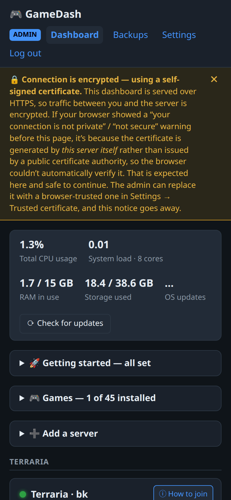
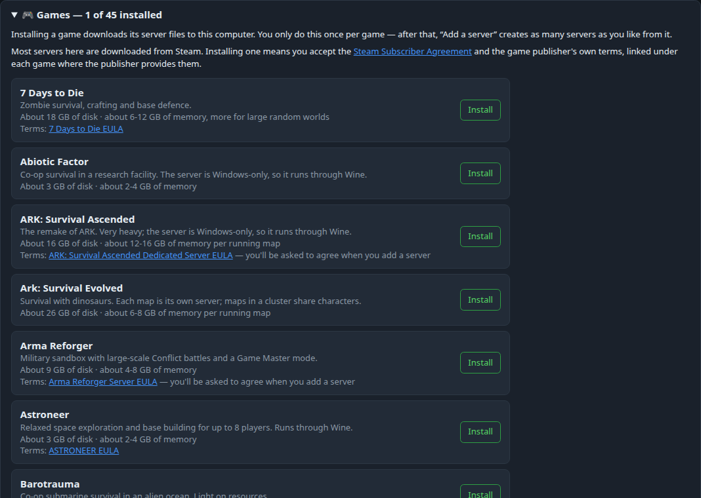
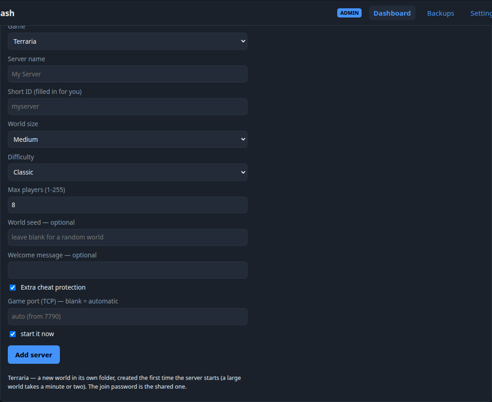
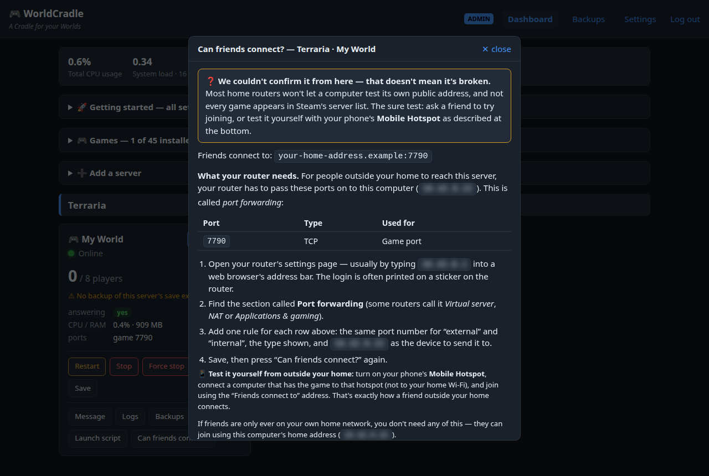

# Getting started with WorldCradle

From a fresh computer to friends playing on your server. No technical knowledge needed — you'll type
a few lines into a terminal once, and do everything else in a web browser.

**You need:** a computer running Ubuntu 22.04 or newer (24.04 or 26.04 recommended) that stays on,
connected to your home internet. Game servers want memory: 8 GB is enough to start, 16 GB or more
for bigger games.

---

## 1. Install WorldCradle (about 2 minutes)

Open a **terminal** on that computer (press `Ctrl` + `Alt` + `T` on Ubuntu) and paste this line:

```
wget -qO- https://raw.githubusercontent.com/KeithDude/WorldCradle/main/get.sh | bash
```

It asks for your computer's password once (the one you log in with), checks the computer is
suitable, installs what's needed and starts WorldCradle. When it's done it shows:

- the **address** to open in your browser (and a QR code for your phone),
- a **one-time setup code**,
- the **password your friends will need** to join your game servers.

Leave that window open for the next step.

## 2. Open the dashboard and choose your password

On any computer or phone at home, open the address it showed, for example
`https://192.168.1.50:8443/`.

Your browser will warn that the connection is "not private". That's expected the first time — the
connection *is* encrypted, the browser just doesn't recognise who made its certificate. Choose
**Advanced**, then **Proceed** (or **Accept the risk**).

Enter the setup code and choose a password for the dashboard (at least 12 characters). This is the
password that controls everything, so make it a good one.

## 3. The dashboard


- At the top: how busy the computer is — **Total CPU usage**, **RAM in use**, **Storage used**.
- **Getting started** walks you through the first steps and ticks them off as you go.
- **Games** is where you install game servers; **Add a server** creates one.
- Each game server gets a card: whether it's running, who is playing, and its buttons.

It works on a phone too:



## 4. Install a game

Open **Games** and press **Install** next to the game you want. The download can take from a few
seconds to half an hour depending on the game (each one shows its size); you can leave the page while
it runs.



Some games ask you to accept the publisher's licence (EULA) — you'll see the link, and you'll be
asked to tick a box when you add a server.

## 5. Add a server

Open **Add a server**, pick the game, give the server a name, and change any options you like — every
game shows the options it really has. Leave the port boxes empty: WorldCradle picks free ones for you.
Keep **start it now** ticked and press **Add server**.



The new server appears as a card. Some games take a few minutes to build their world the first time.

## 6. Let your friends in

Friends on your **home network** can join straight away, using the address shown under
**How to join** on the server's card.

For friends **elsewhere**, your router has to pass the game's ports on to this computer ("port
forwarding"). Press **Can friends connect?** on the server's card — it lists exactly which ports to
forward, with step-by-step instructions, and checks whether it worked.



> 🔒 **Only forward the ports it lists.** Never forward an "admin console" or other control port —
> WorldCradle marks them "keep closed" everywhere. They control the server, and they're never meant to
> be reachable from the internet.

**Test it yourself before telling friends:** turn on your phone's **Mobile Hotspot**, connect the
computer you play on to that hotspot (not to your home Wi-Fi), and join the game using the address
shown next to *Friends connect to*. If that works, it works for your friends too.

Give your friends the address and the **join password** (type `worldcradle passwords` in a terminal to
see it again, or change it in **Settings → Game passwords**).

## 7. Get told when something goes wrong

In **Settings → Alerts**, press **Add a place to send alerts** and pick a service — Discord, Telegram,
email, your phone (ntfy or Pushover) and others. Each one explains where to find what it asks for.
Press **Test**: it tells you straight away whether the message got through. You'll then hear about a
server going down, a server that keeps crashing, or a backup that failed.

## 8. Everyday things

| You want to… | In the dashboard | Or in a terminal |
|---|---|---|
| See if everything's running | the server cards | `worldcradle status` |
| Restart a server | **Restart** on its card (it asks first if players are on) | `worldcradle server restart <name>` |
| Back up or restore a world | **Backups** (a backup is also made every night) | `worldcradle backup <name>` / `worldcradle backup list <name>` |
| Message the players | **Message** on the card (games that support it) | — |
| Forgot the dashboard password | — | `worldcradle reset-password` |
| Update WorldCradle | — | `worldcradle update` |
| Check alerts reach you | **Settings → Alerts → Test** | `worldcradle test-alert` |
| Get help | — | `worldcradle help` |

## If something goes wrong

- **The page won't open:** type `worldcradle status` in a terminal on the WorldCradle computer — it shows
  whether the dashboard is running and the right address. `worldcradle check` looks for common problems.
- **A friend can't join:** press **Can friends connect?** on the server's card and follow it.
- **Still stuck?** Open an issue on GitHub with the **Bug report** form, and include the output of
  `worldcradle version` (never include passwords).

Which games have been tried with real players: [SUPPORTED_GAMES.md](SUPPORTED_GAMES.md).
